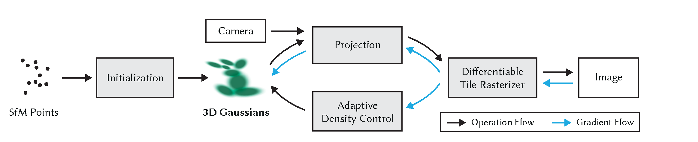
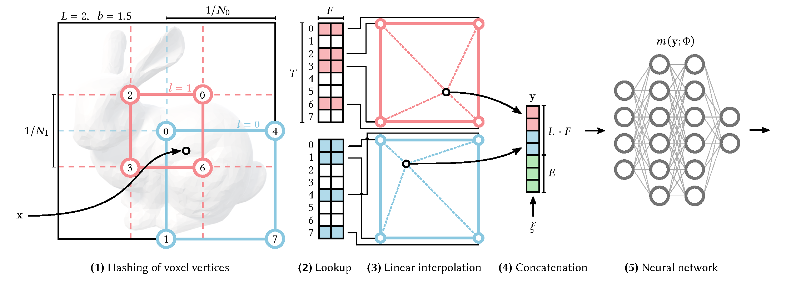
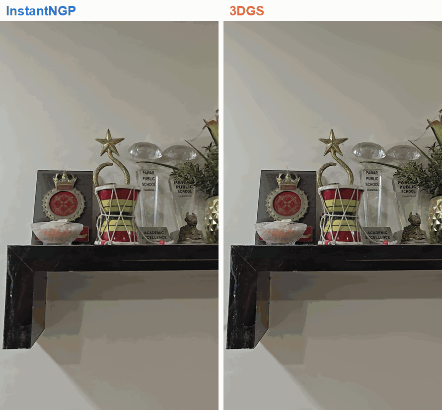
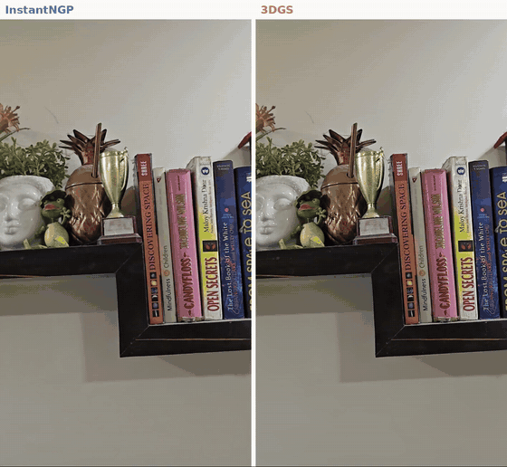
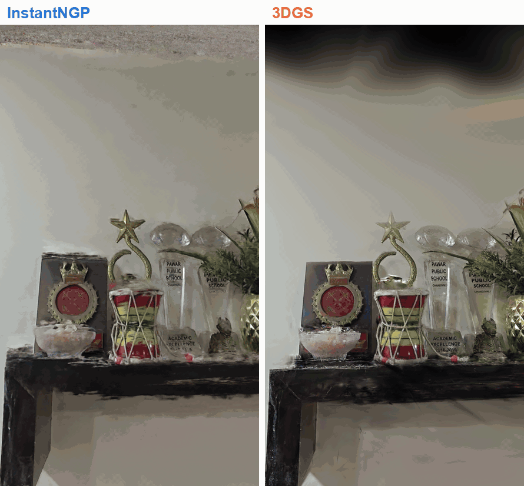

# InstantNGP vs 3D Gaussian Splatting

Comparison of [InstantNGP](https://github.com/NVlabs/instant-ngp) and
[3D Gaussian Splatting](https://github.com/graphdeco-inria/gaussian-splatting) on a self-captured
static scene (a wall shelf, 62 frames from a phone video). Both methods use the same images,
COLMAP poses, train/test split (54 / 8), resolution (701 x 1249), GPU and metric code.

Full report: [REPORT.md](REPORT.md) / [REPORT.pdf](REPORT.pdf)

Interactive 3DGS model in the browser:
[open in viewer](https://antimatter15.com/splat/?url=https://raw.githubusercontent.com/Soham-Gaonkar/splat-host/main/model.splat)
(drag to rotate, scroll to zoom; 37 MB, loads in a few seconds)

## The two methods

### 3D Gaussian Splatting



*3DGS overview (Kerbl et al. 2023, [arXiv:2308.04079](https://arxiv.org/abs/2308.04079), Fig. 2).
The SfM points initialise a set of 3D Gaussians. Each iteration projects them into the camera,
renders them with a differentiable tile rasteriser and back-propagates the image loss; adaptive
density control adds and removes Gaussians during optimisation.*

### InstantNGP



*InstantNGP multiresolution hash encoding (Müller et al. 2022, [arXiv:2201.05989](https://arxiv.org/abs/2201.05989),
Fig. 3), shown in 2D. (1) At each resolution level the corners of the voxel around **x** are hashed
into a table of size T; (2) their F-dimensional feature vectors are looked up; (3) interpolated
linearly; (4) concatenated over the L levels (plus auxiliary inputs ξ, e.g. the view direction);
(5) decoded by a small MLP. In the NeRF setting the output is density and colour, which are
volume-rendered along each ray.*

## Results

RTX 4060 Laptop GPU. Test metrics are averaged over 8 held-out views.

| | InstantNGP (35k steps) | InstantNGP (100k steps) | 3DGS (30k iterations) |
|---|---|---|---|
| PSNR (dB) ↑ | 32.92 | 33.05 | **36.03** |
| SSIM ↑ | 0.9590 | 0.9598 | **0.9789** |
| LPIPS-VGG ↓ | 0.1626 | 0.1618 | **0.1469** |
| Training time | **5.0 min** | 13.9 min | 43.2 min |
| Render time (quality setting) | 155.8 ms (8 spp) | 155.8 ms (8 spp) | **17.4 ms** |
| Render time (1 spp) | 20.3 ms | 20.3 ms | – |
| Model size | **23.5 MB** | **23.4 MB** | 271.8 MB |

3DGS is better on all 8 test views (+1.9 to +3.6 dB PSNR) and renders 9x faster at the evaluated
quality. InstantNGP trains 8.6x faster and its model is 11.6x smaller.

### Time to reach the same test PSNR

| Test PSNR reached | InstantNGP | 3DGS |
|---|---|---|
| 28 dB | **18 s** | 33 s |
| 30 dB | **42 s** | 59 s |
| 31 dB | **76 s** | 79 s |
| 32 dB | 2.6 min | **107 s** |
| 33 dB | 9.5 min | **2.6 min** |
| 35 dB | not reached | 6.9 min |
| 36 dB | not reached | 32.2 min |
| Best reached | 33.05 dB at 13.9 min | 36.03 dB at 43.2 min |

InstantNGP is ahead up to about 31 dB (the first ~1.3 min); from 32 dB on, 3DGS gets there
first. Times are interpolated between saved checkpoints
([`scripts/time_to_psnr.py`](scripts/time_to_psnr.py)), so they are estimates.

### Novel views (left: InstantNGP, right: 3DGS, identical cameras)

**Captured path** (smoothed camera path along the shelf, between the training views)



**Orbit ±30°** (camera swings around the scene centre, beyond the captured viewing angles)



**Camera moved up** (captured path shifted up by 0.15 × scene depth, showing regions never seen by the cameras)



### Detail


### Convergence and efficiency


All figures are in [`results/figures/`](results/figures/); all numbers are in
[`results/summary.md`](results/summary.md) and [`results/metrics/`](results/metrics/).

## Repository layout

| Path | Content |
|---|---|
| `data/scene/images/` | 62 undistorted frames (ground truth for both methods) |
| `data/scene/input/` | original extracted frames |
| `data/scene/sparse/0/`, `colmap_text/` | COLMAP model (62/62 registered, 16,573 points, 0.40 px error) |
| `data/scene/transforms_{train,test}.json` | InstantNGP poses and split |
| `data/scene/novel/` | 7 novel camera paths (same cameras for both methods) |
| `scripts/` | pipeline: training wrappers, rendering, metrics, figures |
| `results/` | metrics, timings, summary, figures, GIFs |
| `logs/` | training logs, timing and GPU memory logs, environment |

## Setup

Requires an NVIDIA GPU and Linux. On Windows, use WSL2 with **Ubuntu 22.04** (its gcc 11 works
with CUDA 11.8); work inside the Linux home directory, not under `/mnt/c`.

```bash
# 1. this repository and the two model repositories at the tested commits
git clone <this-repo-url> assignment2 && cd assignment2
git clone --recursive https://github.com/graphdeco-inria/gaussian-splatting repos/gaussian-splatting
git -C repos/gaussian-splatting checkout 54c035f7834b564019656c3e3fcc3646292f727d
git -C repos/gaussian-splatting submodule update --init --recursive
git clone --recursive https://github.com/NVlabs/instant-ngp repos/instant-ngp
git -C repos/instant-ngp checkout abe236ee00cf90cfca6e36e65c00435d5b21f50a
git -C repos/instant-ngp submodule update --init --recursive

# 2. 3DGS environment (set TORCH_CUDA_ARCH_LIST to your GPU's compute capability)
conda create -n gs python=3.10 -y && conda activate gs
conda install -c "nvidia/label/cuda-11.8.0" cuda-toolkit -y
pip install torch==2.1.2 torchvision==0.16.2 --index-url https://download.pytorch.org/whl/cu118
pip install plyfile tqdm opencv-python joblib lpips matplotlib scipy pillow
export CUDA_HOME=$CONDA_PREFIX TORCH_CUDA_ARCH_LIST="8.9"
pip install --no-build-isolation repos/gaussian-splatting/submodules/{diff-gaussian-rasterization,simple-knn,fused-ssim}

# 3. InstantNGP environment (set TCNN_CUDA_ARCHITECTURES, e.g. 89 for RTX 40xx)
conda create -n ngp python=3.10 -y && conda activate ngp
conda install -c "nvidia/label/cuda-11.8.0" cuda-toolkit -y
pip install cmake -r repos/instant-ngp/requirements.txt
export CUDA_HOME=$CONDA_PREFIX TCNN_CUDA_ARCHITECTURES=89
cmake -S repos/instant-ngp -B repos/instant-ngp/build -DCMAKE_BUILD_TYPE=RelWithDebInfo \
      -DNGP_BUILD_WITH_GUI=off -DCMAKE_CUDA_COMPILER=$CONDA_PREFIX/bin/nvcc
cmake --build repos/instant-ngp/build --config RelWithDebInfo -j 4
```

## Reproduce

```bash
conda deactivate
DRY_RUN=1 bash scripts/run_all.sh          # print all commands
bash scripts/run_all.sh                    # train, render, benchmark, evaluate, plot
```

`run_all.sh` runs three stages, which can also be run separately:

| Stage | Steps |
|---|---|
| `scripts/run_gs.sh` | train 3DGS for 30k iterations; render test views at each checkpoint; time rendering; render novel paths; run the official `metrics.py` as a cross-check |
| `scripts/run_ngp.sh` | train InstantNGP with checkpoints up to 100k steps; render test views; time rendering at 1 and 8 spp; render novel paths |
| `scripts/run_eval.sh` | PSNR / SSIM / LPIPS for every checkpoint, `results/summary.md`, all figures and videos |

Iteration lists and environment names are set in `scripts/config.sh`.
To rebuild the README GIFs: `python scripts/make_gifs.py --novel outputs/novel --out results/media`.
To rebuild the PDF: `python scripts/build_report_pdf.py`.

Data preparation (already done; outputs are in `data/scene/`):

```bash
ffmpeg -i raw/shelf.mp4 -vf "fps=6,scale=720:1280:flags=lanczos" -q:v 2 data/candidates/frame_%05d.jpg
python scripts/filter_frames.py --group 3
python repos/gaussian-splatting/convert.py -s data/scene --no_gpu     # COLMAP 4.x: see scripts/patches/
python scripts/prepare_ngp.py
python scripts/make_novel_paths.py
```
