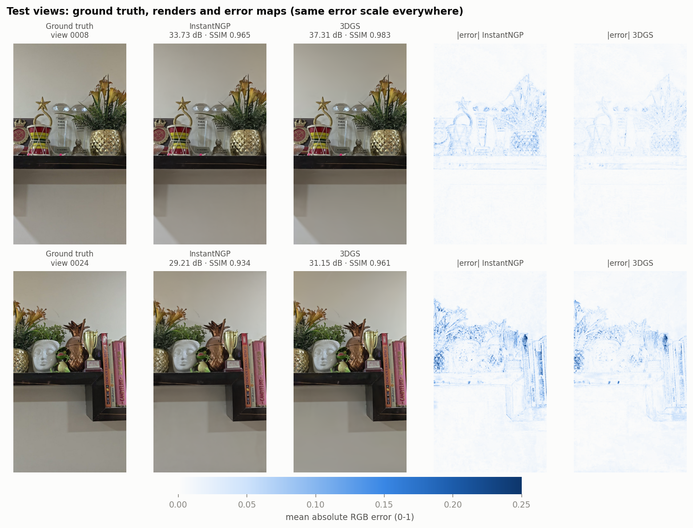

# InstantNGP vs 3D Gaussian Splatting 

E9 247 : Assignment 2

Name : Soham Gaonkar

SR no.: 28875 

This report compares InstantNGP [1] and 3D Gaussian Splatting (3DGS) [2] on a self-captured
static indoor scene, using the same images, camera poses, train/test split, resolution, GPU
and metric code for both methods.

## 1. Dataset

### 1.1 Capture

- **Scene:** wall-mounted shelf with books, ornaments, plants and trophies (static, indoor)
- **Device / mode:** phone camera, video
- **Video:** 1080 x 1920 (portrait), 30 fps, HEVC, 31.1 s
- **Camera motion:** one sideways pass along the shelf at constant height and distance, without rotating the camera
- **Lighting:** indoor room lighting

### 1.2 Frame selection

- **Extraction (ffmpeg):** 6 fps, resized to 720 x 1280 (Lanczos), giving 186 candidate frames
- **Sharpness filter:** variance of the Laplacian; the sharpest frame in each group of 3 consecutive frames is kept, giving 62 frames
- **Visual inspection:** checked for blur, moving objects and the photographer's shadow; all 62 frames were kept

*Figure 1. Sharpness (variance of the Laplacian) of all candidate frames; kept frames highlighted.*

### 1.3 Camera poses (COLMAP)

Camera poses were estimated with COLMAP 4.2.0 (through the 3DGS `convert.py` script): all 62
images registered, 16,573 sparse 3D points, mean reprojection error 0.40 px. The images were then
undistorted to 701 x 1249, the resolution both methods train on.

*Figure 2. COLMAP sparse point cloud (front and top view).*

Every 8th image (sorted by name, the rule 3DGS uses with `--eval`) was held out for testing:
54 training and 8 test images (0000, 0008, ..., 0056).

## 2. Methods and settings

### 2.1 3D Gaussian Splatting

| Setting | Value |
|---|---|
| Code | graphdeco-inria/gaussian-splatting, commit `54c035f` |
| Initialisation | 16,573 COLMAP points |
| Iterations | 30,000 (official default) |
| Resolution | full (`-r 1`), 701 x 1249 |
| Densification | every 100 iterations from 500 to 15k: clone small and split large Gaussians with a high view-space gradient (> 0.0002), prune those with opacity < 0.005; opacity reset every 3k |
| Other hyper-parameters | repository defaults (SH degree 3, loss 0.8·L1 + 0.2·D-SSIM) |
| Checkpoints saved | 1k, 3k, 7k, 15k, 30k |

### 2.2 InstantNGP

| Setting | Value |
|---|---|
| Code | NVlabs/instant-ngp, commit `abe236e`, default network `configs/nerf/base.json` |
| Encoding | multiresolution hash grid: 8 levels x 4 features, table size 2^19, base resolution 16 |
| MLPs | density: 1 hidden layer x 64; colour: 2 hidden layers x 64 |
| Steps | 35,000 (default schedule) and continued to 100,000 to confirm convergence |
| `aabb_scale` | 4 |
| Checkpoints saved | 1k, 3k, 7k, 15k, 35k, 100k |
| Rendering for evaluation | 8 samples per pixel, black background (as in `run.py`) |

**Pose normalisation.** `colmap2nerf.py` centres the scene at the point where all optical axes
intersect. With a sideways capture the axes are almost parallel, and this point fell 3.4 units
(normalised scale) behind the wall, leaving the shelf far from the centre of InstantNGP's
volume. The poses were therefore recentred on the median of the COLMAP points and scaled so the
farthest camera is 1 unit from the centre. This is a similarity transform; image content,
intrinsics and relative poses are unchanged.

## 3. Evaluation protocol

PSNR measures pixel-wise error, SSIM local structure and contrast, and LPIPS perceptual
similarity (closer to human judgement of blur and texture), so together they cover both exact
accuracy and visual quality.

| Item | Protocol |
|---|---|
| Metrics | one script for both methods. PSNR per image (images in [0,1]); SSIM with an 11x11 Gaussian window, σ = 1.5 (same implementation as 3DGS); LPIPS v0.1 with VGG and AlexNet backbones, inputs in [-1,1]. Values are averaged over the 8 test views. |
| Metric check | the official 3DGS `metrics.py`, run on the same renders, gives PSNR 36.030 and SSIM 0.9789, identical to our values |
| Training time | wall-clock time of the full training process, including data loading and checkpoint saving |
| Rendering time | mean over 8 test views x 20 repeats after 10 warm-up renders, at 701 x 1249. 3DGS: CUDA-synchronised around `render()`. InstantNGP: `testbed.render()`, which returns the image to host memory. |
| Model size | file on disk: 3DGS `point_cloud.ply`; InstantNGP `.ingp` snapshot (zlib-compressed by default) |
| GPU memory | peak of `nvidia-smi` memory used, sampled once per second during training (whole GPU) |
| Hardware | NVIDIA GeForce RTX 4060 Laptop GPU (8 GB, compute capability 8.9), driver 591.44, WSL2 Ubuntu 22.04, gcc 11.4 |

Sizes are given in MB = 2^20 bytes.

## 4. Results

### 4.1 Summary

| | InstantNGP 35k | InstantNGP 100k | 3DGS 30k |
|---|---|---|---|
| PSNR (dB) ↑ | 32.92 | 33.05 | **36.03** |
| SSIM ↑ | 0.9590 | 0.9598 | **0.9789** |
| LPIPS-VGG ↓ | 0.1626 | 0.1618 | **0.1469** |
| LPIPS-Alex ↓ | 0.0606 | 0.0595 | **0.0376** |
| Training time (wall clock) | **5.0 min** (301 s) | 13.9 min (834 s) | 43.2 min (2594 s) |
| Render time, quality setting | 155.8 ms (6.4 FPS, 8 spp) | 155.8 ms (6.4 FPS, 8 spp) | **17.4 ms (57.6 FPS)** |
| Render time, 1 spp | 20.3 ms (49.2 FPS) | 20.3 ms (49.2 FPS) | – |
| Model file | **23.5 MB** | **23.4 MB** | 271.8 MB |
| Trainable parameters | 12.87 M | 12.87 M | 67.79 M (1,148,987 Gaussians x 59) |
| Peak GPU memory during training | – | 1209 MiB | 4305 MiB |

Render times were measured on the 100k model; the network size, and therefore the cost per
sample, is the same at 35k. All quality numbers for InstantNGP are from 8 spp renders, so the
8 spp time is the one that matches its reported quality.

*Figure 3. Training time, rendering speed (InstantNGP at 1 spp), model size and peak GPU memory.*

### 4.2 Per-view quality

| View | PSNR NGP | PSNR 3DGS | Δ PSNR | SSIM NGP | SSIM 3DGS | LPIPS-VGG NGP | LPIPS-VGG 3DGS |
|---|---|---|---|---|---|---|---|
| 0000 | 33.15 | 36.03 | +2.88 | 0.9557 | 0.9783 | 0.2036 | 0.1759 |
| 0008 | 33.73 | 37.31 | +3.58 | 0.9653 | 0.9826 | 0.1593 | 0.1435 |
| 0016 | 33.26 | 36.53 | +3.27 | 0.9624 | 0.9821 | 0.1624 | 0.1434 |
| 0024 | 29.21 | 31.15 | +1.93 | 0.9343 | 0.9605 | 0.1823 | 0.1634 |
| 0032 | 34.08 | 37.55 | +3.46 | 0.9678 | 0.9840 | 0.1482 | 0.1470 |
| 0040 | 32.74 | 35.52 | +2.77 | 0.9622 | 0.9796 | 0.1404 | 0.1327 |
| 0048 | 33.38 | 36.11 | +2.73 | 0.9642 | 0.9809 | 0.1475 | 0.1330 |
| 0056 | 34.84 | 38.05 | +3.21 | 0.9669 | 0.9829 | 0.1506 | 0.1366 |
| **Mean** | **33.05** | **36.03** | **+2.98** | **0.9598** | **0.9789** | **0.1618** | **0.1469** |

NGP = InstantNGP at 100k steps; 3DGS at 30k iterations; Δ = 3DGS − NGP.

3DGS is better on all 8 views and all four metrics. The PSNR gap ranges from 1.93 to 3.58 dB.

*Figure 4. Per-view PSNR, SSIM and LPIPS-VGG (horizontal lines: means).*

### 4.3 Convergence

| 3DGS iteration | 1k | 3k | 7k | 15k | 30k |
|---|---|---|---|---|---|
| Wall time (min) | 0.5 | 2.0 | 7.2 | 20.5 | 43.2 |
| PSNR (dB) | 27.57 | 32.48 | 35.08 | 35.95 | 36.03 |
| SSIM | 0.9151 | 0.9649 | 0.9765 | 0.9791 | 0.9789 |
| LPIPS-VGG | 0.2520 | 0.1732 | 0.1557 | 0.1498 | 0.1469 |
| Gaussians | 75,419 | 725,555 | 1,061,681 | 1,148,987 | 1,148,987 |

| InstantNGP step | 1k | 3k | 7k | 15k | 35k | 100k |
|---|---|---|---|---|---|---|
| Wall time (min) | 0.2 | 0.5 | 1.0 | 2.2 | 5.0 | 13.9 |
| PSNR (dB) | 26.59 | 29.28 | 30.74 | 31.73 | 32.92 | 33.05 |
| SSIM | 0.8850 | 0.9265 | 0.9427 | 0.9514 | 0.9590 | 0.9598 |
| LPIPS-VGG | 0.2685 | 0.2106 | 0.1864 | 0.1741 | 0.1626 | 0.1618 |

Both methods have converged:
- **3DGS:** +0.08 dB PSNR and −0.0002 SSIM from 15k to 30k.
- **InstantNGP:** +0.13 dB PSNR and +0.0008 SSIM from 35k to 100k, for 2.8x the training time.

*Figure 5. Test metrics against iterations (top, log scale) and against wall-clock training time (bottom).*

**Time to reach the same test PSNR** (wall clock, same GPU):

| Test PSNR reached | InstantNGP | 3DGS |
|---|---|---|
| 28 dB | **18 s** | 33 s |
| 30 dB | **42 s** | 59 s |
| 31 dB | **76 s** | 79 s |
| 32 dB | 2.6 min | **107 s** |
| 33 dB | 9.5 min | **2.6 min** |
| 35 dB | not reached | 6.9 min |
| 36 dB | not reached | 32.2 min |
| Best reached | 33.05 dB at 13.9 min | 36.03 dB at 43.2 min |

Times are interpolated between the saved checkpoints (PSNR assumed linear in log time between
two checkpoints; `scripts/time_to_psnr.py`), so they are estimates. With only 5–6 checkpoints
per method, individual entries may be off by about ±20 %; the crossover near 31 dB is robust.

Observations:

- **InstantNGP is ahead only up to about 31 dB (the first ~1.3 min).** After 7 min, 3DGS
  (35.1 dB) exceeds the best InstantNGP result at any training length (33.05 dB).
- **Half of 3DGS's training time adds 0.08 dB.** The Gaussian count stops changing at 15k
  iterations, when densification ends. 3DGS's cost per iteration grows with the number of
  Gaussians: iterations 15k–30k take (2591 − 1229) s / 15000 = 91 ms each, 22.7 of the 43.2 minutes.
- **3DGS fits its training views much better than the test views.** Its own logs at 30k report
  40.30 dB on training views and 36.06 dB on test views (a 4.2 dB gap). The 36.06 dB is computed
  on float renders; our 36.03 dB is computed on the saved 8-bit PNGs.

### 4.4 Rendering time

spp = samples per pixel: the number of slightly offset rays InstantNGP traces through each pixel
and averages; more spp gives less noise but costs proportionally more time.

| | ms / frame (mean ± std) | FPS |
|---|---|---|
| 3DGS | 17.4 ± 1.7 | 57.6 |
| InstantNGP, 1 spp | 20.3 ± 1.6 | 49.2 |
| InstantNGP, 8 spp (setting used for the quality metrics) | 155.8 ± 12.5 | 6.4 |

At the settings that produce the reported quality, 3DGS renders 9.0x faster. At 1 spp the two
methods are close in speed on this laptop GPU, but InstantNGP's 1 spp images contain more
sampling noise than the 8 spp images that were evaluated. 3DGS rasterises 1.15 M Gaussians.
InstantNGP marches rays through its occupancy grid and evaluates the hash encoding and two MLPs
per sample.

### 4.5 Model size

| | InstantNGP | 3DGS |
|---|---|---|
| File on disk | 23.4 MB (.ingp, compressed) | 271.8 MB (.ply) |
| Uncompressed | 36.6 MB | 271.8 MB |
| Content | 12.87 M parameters (fp16): hash tables 12,855,296, MLPs 10,240; plus fp16 occupancy grid (3 x 128³ cells) | 1,148,987 Gaussians x 62 float32 values (position, normal, 48 SH colour coefficients, opacity, 3 scales, 4 rotation) |

Both sizes follow from the contents (fp16 = 2 bytes, float32 = 4 bytes):

- **InstantNGP (uncompressed):** (parameters + occupancy cells) x 2 B = (12,865,536 + 3 x 128³) x 2 B
  = 38.31 x 10^6 B, against 38.35 x 10^6 B measured (the rest is configuration metadata).
- **3DGS:** Gaussians x 62 values x 4 B = 1,148,987 x 62 x 4 B = 284.95 x 10^6 B = 271.8 MB.

3DGS is 11.6x larger on disk. 48 of its 59 learned values per Gaussian are spherical-harmonic
colour coefficients. The InstantNGP model has a fixed size from the first step, while 3DGS grows
during densification (Figure 6).

*Figure 6. Model file size during training.*

### 4.6 Visual comparison

*Figure 7. Ground truth, InstantNGP, 3DGS and absolute error maps (common scale) for the view with
the largest PSNR gap (0008) and the worst view (0024).*

*Figure 8. Crops at the highest-detail regions of the views with the largest PSNR gap (0008, 0032)
and of the hardest view (0024).*

Observations:

- Both methods reproduce the scene geometry, colours and the static shadows under the shelf.
  Neither shows floaters in the test views.
- **Fine texture and text:** 3DGS reproduces small book-spine text ("Simon & Schuster", barcodes)
  and the facets of the gold pot close to the ground truth. In InstantNGP the same details are
  soft and small text is not readable (Figure 8, rows 1–2).
- **Shiny surfaces:** on the trophy (view 0024) the ground truth shows a fine specular texture.
  3DGS keeps most of it; InstantNGP renders a smooth, blurred highlight.
- **Error maps:** both concentrate on edges and textured objects. The plain wall has near-zero
  error for both.

### 4.7 Sharpness analysis (variance of the Laplacian)

*Figure 9. Relative sharpness of each test render.*

InstantNGP renders keep 53 % of the ground-truth sharpness on average, 3DGS keeps 90 %. This is
the loss of fine detail seen in Figure 8.

### 4.8 Novel views away from the capture path

Seven camera paths were rendered with identical cameras for both methods: the captured path
(smoothed), the path shifted up and down by 0.15 x scene depth, a spiral around it, a dolly
along the viewing axis, a ±30° orbit around the scene centre, and a ±20° look-around pan.

*Figure 10. One frame per path at its largest deviation from the captured views; top InstantNGP, bottom 3DGS, same camera.*

Per-path frame strips: `results/figures/13_novel_<path>.png`.

- **trajectory, spiral and dolly** (inside or close to the captured views): both methods give
  clean images; 3DGS is sharper, matching the test-view results.
- **shift_up / shift_down** expose wall and shelf regions never seen by the cameras.
  - InstantNGP fills them with grainy, noisy texture.
  - 3DGS shows smooth dark or coloured blobs at the frame borders (large, low-opacity Gaussians
    that were never constrained from these directions).
- **orbit and look_around** point the camera partly outside the captured volume.
  - InstantNGP renders black where rays leave its bounding box (`aabb_scale` 4).
  - 3DGS shows stretched, smeared splats on the side of the shelf.
  - The shelf itself stays recognisable in both.
- A single horizontal pass gives almost no vertical parallax, so neither method can recover
  surfaces that are hidden from the capture line (tops of books, the area behind objects).

### 4.9 3DGS model statistics

*Figure 11. Opacity, size and anisotropy of the 1,148,987 Gaussians at 30k iterations.*

- **Count:** densification grew the 16,573 SfM points to 1,148,987 Gaussians (69x).
- **Opacity:** median 0.06. Most Gaussians are nearly transparent and contribute through
  accumulation; a separate group is fully opaque (peak at 1.0).
- **Size:** the largest axis is typically 10^-1.6 COLMAP units, about 0.4 % of the scene depth.
- **Shape:** the ratio of largest to smallest axis has its mode around 100:1. The scene is
  represented mostly by flat, disc- or needle-like splats aligned with surfaces.

## 5. Conclusion

| Criterion | Better method | Margin on this scene |
|---|---|---|
| Test-view quality | 3DGS | +2.98 dB PSNR, +0.019 SSIM, −0.015 LPIPS-VGG, −0.022 LPIPS-Alex; better on all 8 views |
| Rendering time at evaluated quality | 3DGS | 17.4 ms vs 155.8 ms (9.0x) |
| Model size | InstantNGP | 23.4 MB vs 271.8 MB (11.6x smaller) |
| Training time to convergence | InstantNGP | 5.0 min vs 43.2 min (8.6x); 3DGS is 0.08 dB from its final quality after 20.5 min |
| Training GPU memory | InstantNGP | 1.2 GB vs 4.3 GB (whole-GPU peak) |

- **Representation.** 3DGS stores an explicit, adaptive set of anisotropic primitives. Their
  number grew to 1.15 M exactly where the scene has detail (text, leaves, faceted objects), which
  gives sharp renders and high-frequency fidelity but a large model. InstantNGP stores a fixed
  hash grid (12.9 M parameters, shared through hashing) and two small MLPs. It is compact and
  fast to train, but its renders lose fine detail (Figures 8, 9).
- **Rendering.** Rasterising sorted Gaussians costs one pass per image. Volume rendering costs
  many network evaluations per ray, and InstantNGP needs several samples per pixel to reach the
  quality reported here.
- **Shiny surfaces.** On the trophy and the gold pot, InstantNGP produces smooth highlights.
  3DGS keeps more of the fine specular texture, but its view-dependent colour (degree-3 spherical
  harmonics) can only interpolate between the captured directions.
- **Extrapolation.** Both methods are reliable only near the captured line. Their failure modes
  differ: noise and empty space for InstantNGP, smeared splats for 3DGS.

## 6. Limitations

1. **Shadows and reflections.** The scene contains static soft shadows below the shelf and
   specular highlights on the ceramic, glass and metal objects. They are static and consistent
   across views, but the shiny objects are where both methods have their largest local errors.
2. **Small test set.** 8 test views from a single sideways pass, all close to the training
   cameras. The metrics measure interpolation quality, not wide-baseline novel-view synthesis.
3. **Uneven capture speed.** The walking speed along the shelf was not constant. Six test views
   lie within 0.7 camera spacings of a training camera, but views 0040 and 0024 lie 1.7 and 2.1
   spacings away. These two are the lowest-scoring test views for both methods (0024: 29.21 /
   31.15 dB), so both methods lose quality as the distance to the nearest training view grows.
4. **InstantNGP render speed depends on spp.** 1 spp is 7.7x faster than 8 spp but noisier;
   quality was measured only at 8 spp.
5. **One scene, one run per method.** No variance over random seeds was measured.

## 7. Links

- Code, data, results and setup instructions:
  [github.com/Soham-Gaonkar/Comparing-InstantNGP-and-3DGS](https://github.com/Soham-Gaonkar/Comparing-InstantNGP-and-3DGS)
- Interactive 3DGS model in the browser:
  [antimatter15 splat viewer](https://antimatter15.com/splat/?url=https://raw.githubusercontent.com/Soham-Gaonkar/splat-host/main/model.splat)

## References

[1] T. Müller, A. Evans, C. Schied, A. Keller. Instant Neural Graphics Primitives with a
Multiresolution Hash Encoding. ACM Transactions on Graphics (SIGGRAPH), 2022.

[2] B. Kerbl, G. Kopanas, T. Leimkühler, G. Drettakis. 3D Gaussian Splatting for Real-Time
Radiance Field Rendering. ACM Transactions on Graphics (SIGGRAPH), 2023.

[3] J. L. Schönberger, J.-M. Frahm. Structure-from-Motion Revisited. CVPR, 2016.

[4] R. Zhang, P. Isola, A. A. Efros, E. Shechtman, O. Wang. The Unreasonable Effectiveness of
Deep Features as a Perceptual Metric (LPIPS). CVPR, 2018.
